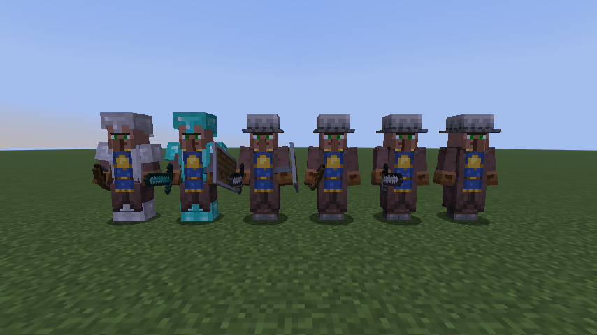
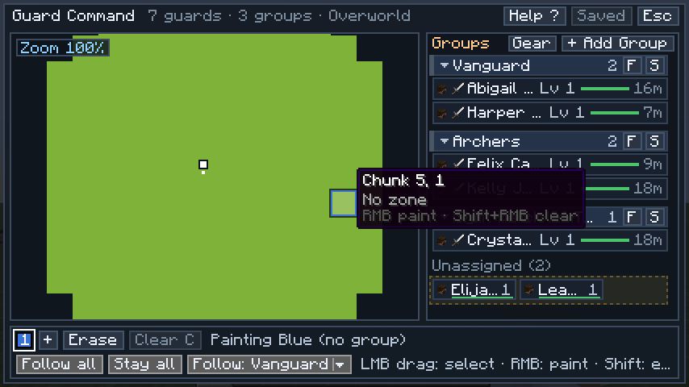
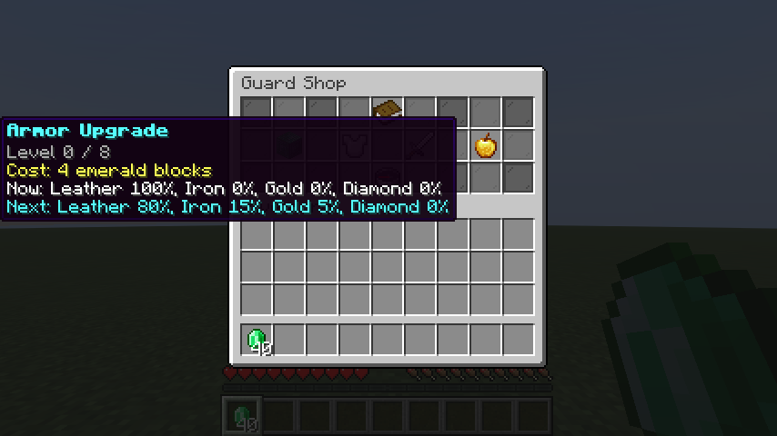
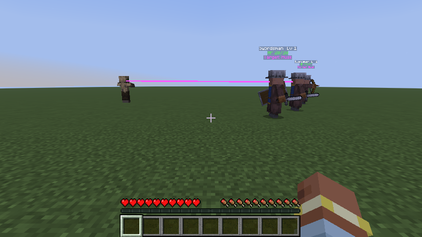

# Guard Villagers

A Fabric mod that adds villager guards. Villages raise their own garrison, and you can hire personal guards with emerald blocks, sort them into groups, and lead them through a commander you talk to by text or by voice.



## Contents

- [Features](#features)
- [Requirements](#requirements)
- [Install](#install)
- [Getting started](#getting-started)
- [Guards](#guards)
- [Commander, captains and orders](#commander-captains-and-orders)
- [Command post (tactics screen)](#command-post-tactics-screen)
- [Shop and upgrades](#shop-and-upgrades)
- [Reputation and trust](#reputation-and-trust)
- [Commands](#commands)
- [Voice setup](#voice-setup)
- [Upgrading from 1.21.11](#upgrading-from-12111)
- [Building from source](#building-from-source)
- [License](#license)

## Features

- Village guards that spawn around populated villages and answer the village bell.
- Up to 16 personal guards per player, hired in a shop or claimed from a village.
- Two roles (Swordsman, Bowman), four behaviors, formations, patrol zones and a hold mode.
- A chain of command: one commander per player and one captain per group, chosen by seniority or by you.
- Orders in plain English through `/guards say`, a `!g` chat prefix, or your voice with Simple Voice Chat.
- A commander that reacts on its own: defends you, assigns guards to threats, pulls the wounded back, answers raids.
- A command post screen with a paintable chunk map and drag-and-drop groups.
- Account-wide shop upgrades for armor, weapons and healing.
- Per-player reputation that decides whether guards trust you.

## Requirements

| Component | Version |
| --- | --- |
| Minecraft | `26.1.2` |
| Java | `25` |
| Fabric Loader | `0.19.5` or newer |
| Fabric API | `0.155.3+26.1.2` or newer |
| Simple Voice Chat | Optional, `2.6.21` or newer. Only needed for voice orders. |

## Install

1. Install Fabric Loader for Minecraft 26.1.2.
2. Put Fabric API and `guard-villagers-2.0.0.jar` in the `mods` folder.
3. Optional: add Simple Voice Chat on both server and client for voice orders. See [Voice setup](#voice-setup).

The mod is needed on both the server and the client.

## Getting started

1. Get emerald blocks and run `/guards shop`.
2. Click **Hire a Guard**. It appears at your feet and follows you.
3. Right-click it with an empty hand to toggle stay and follow.
4. Type `/guards say hold the line` or `!g follow me` to give an order.
5. Run `/guards tactics` to open the command post and sort guards into groups.

The Guard Whistle and the Guard Spawn Egg are in the mod's creative tab. The whistle has no recipe; use the creative tab or `/give @s guardvillagers:guard_whistle`.

## Guards

### Village guards and personal guards

- **Village guards** spawn around villages based on how many villagers and doors the village has, and are replaced over time. They defend the village and gather at the bell when it rings.
- **Personal guards** belong to one player. You can own up to 16. Get them by:
  - hiring in `/guards shop` (emerald blocks), or
  - right-clicking an unowned guard with emeralds, if your reputation is at least `0.50`. Price: `4 + 2 x (level - 1)` emeralds.

Guards gain XP from kills and slowly over time, up to level 10. Support level 2 gives every new guard a shield.

### Roles

| Role | Fights with |
| --- | --- |
| Swordsman | Sword, up close |
| Bowman | Bow, at range |

Shop hires alternate between the two roles.

### Behaviors

Sneak + right-click your guard with an empty hand to cycle: Perimeter, Crowd Control, Offensive, Defensive. New and hired guards start as Defensive.

| Behavior | What the guard does |
| --- | --- |
| Defensive | Stays near you or its home. In a raid, holds positions around the raid centre. |
| Offensive | In a raid, goes after the nearest raider. |
| Perimeter | Walks the edge and inside of its village or zone. |
| Crowd Control | Holds a spot around the village bell, its home, or where it started. |

All guards retreat to heal at low health (toward a cleric, a bed, or home) and fight back if cornered.

### Follow, stay, hold and zones

| State | How to set it | Effect |
| --- | --- | --- |
| Follow | Right-click (empty hand), `/guards follow`, "follow me" | Walks with you in a formation ring, catches up along your path. |
| Stay | Right-click again, `/guards stay`, "stay" | Stays put. |
| Hold | `/guards hold`, "hold the line" | Stands on its block, fights only what it can reach (bowmen shoot from position), never walks away. Follow, stay and home orders clear it. |
| Home zone | Whistle on the guard, `/guards zone <radius>`, "patrol here" | Patrols around a home point and walks back if it strays out. |

### Formations

`FOLLOW` is the default ring around you. Orders can put guards in a `LINE`, `SQUARE` or `CIRCLE` in front of you for a limited time (60 s by default): swordsmen take the front posts, bowmen the back.

### Whistle

| Action | Effect |
| --- | --- |
| Right-click in air | Open the command post. |
| Sneak + right-click in air | Rally your captains and commander within 64 blocks to you for 12 s; they target whatever last hurt you. |
| Right-click your guard | Set its home to where it stands (radius at least 24). |
| Sneak + right-click your guard | Grow its patrol radius by 8 (16 to 96). |

### Giving gear

Right-click your own guard while holding:

- a better sword (swordsman) or a bow with higher Power (bowman), to swap its weapon;
- a better armor piece while sneaking within 5 blocks. Equal tier counts only with higher Protection.

### Bell rally

Ringing a bell (by hand, projectile or redstone) calls guards to it for 12 s:

- unowned village guards within 32 blocks;
- personal guards whose home is in that village, if the ringer is their owner, a player the owner trusts, or redstone.

Each bell rallies at most once every 5 s.

### Hitting guards

- Your own guards never fight back when you hit them.
- A player's first light hit on someone else's guard is forgiven: no reputation loss and no retaliation, if it dealt at most 2 hearts, the player had not hit a guard in the last 5 s, and their reputation is at least `0.25`.
- Other hits cost reputation and the guard and its squad fight back.

## Commander, captains and orders

### Chain of command

- **Commander:** your most senior loaded guard. Seniority is level, then XP, then time in service.
- **Captain:** the most senior guard of each group that has at least 2 loaded members.
- Ranks are rechecked every 5 s and right after a hire, death, unload or group change. Only a strictly higher level unseats a rank holder, so ranks do not flicker.
- When a commander falls, the most senior captain within 64 blocks of you takes over, and the commander announces it.
- Appoint ranks yourself: look at a guard within 8 blocks and run `/guards appoint commander` or `/guards appoint captain`, or say "make Liam commander". Appointed guards keep their rank until they die or you run `/guards appoint auto`.

### What the commander does on its own

Unless you turn it off with `/guards commander auto off`, the commander plans every 2 s (sooner when you are hurt or give an order):

1. Guards under your order, stay, hold, a rally or a retreat are left alone. They still defend themselves.
2. Whoever hurts you, or any hostile within 12 blocks of you, gets the nearest guards.
3. Homed squads near a raid switch to raid tactics and rally to the bell.
4. Other threats are assigned highest score first to the nearest free guards: bowmen against slow melee mobs and creepers, swordsmen against ranged mobs. A small bodyguard detail stays with you.
5. A fight whose guards average under 60% health gets two more.
6. A guard under 30% health is pulled back to you and not reassigned until above 50%.
7. Archers step behind you, away from the threat, so swordsmen take the front.
8. After 30 s of quiet, homed squads walk a loop around their home every minute.

It reports in chat and in the action bar ("Area clear.", "Liam is wounded. Pulling him back.") and, with voice set up, out loud from the commander's position.

### Giving orders

Three ways to give the same orders, all handled by the same interpreter:

- `/guards say <text>`
- Chat starting with `!g ` (for example `!g alpha hold the line`). These messages are not broadcast.
- Your voice through Simple Voice Chat, after `/guards voice on`.

An order is `[who] <what> [who]`, in either order: `alpha, hold the line`, `hold the line alpha`. Chain up to three with "and", "then" or "after that": `alpha form a line and archers follow me`. A later order without a name reuses the earlier one's name. Filler words ("uh", "please", "now", "okay", "can you", "I need you to") are ignored, number words become digits, and small typos or common mishearings ("hole the line", "commanda", "petrol here") still match.

**Who** (scope):

| Say | Reaches |
| --- | --- |
| nothing, or guards, guard, everyone, everybody, all, squad, team, men, troops, soldiers, units, boys, lads, y'all | All your loaded guards |
| commander | Your commander only |
| a group name, with or without "squad", "team" or "group" in front ("alpha", "squad blue") | That group |
| a guard's name ("Liam") | That guard |
| archers, archer, bowmen, bowman, bows | Your bowmen |
| swordsmen, swordsman, swords, fighters | Your swordsmen |

`commander, alpha hold` relays through the commander to Alpha.

**What** (every phrase the built-in grammar understands):

| Order | Phrases | Lasts |
| --- | --- | --- |
| Follow | follow me, follow, on me, with me, come with me, fall in, stay with me, stick with me, follow us, keep up | Until changed |
| Stay | stay, stay here, stay put, wait, wait here, stop, halt | Until changed |
| Hold | hold, hold position, hold your position, hold the line, hold here, hold this position, stand your ground, hold your ground, hold fast | Until changed |
| Come here | come here, to me, report to me, over here, get over here, come to me, come over here | Timed |
| Attack my target | attack, attack that / this / it / him / her / them, attack my target, kill it / that / him / her / them, get him / her / them / it / that, charge | Timed |
| Attack my attacker | attack my attacker, get / attack / kill whoever hit me, attack / get whoever is attacking me, protect me, defend me | Timed |
| Attack nearest hostile | engage; attack / kill / get / engage (the) nearest enemy / hostile / mob / monster | Timed |
| Defend the village | defend the village, guard the village, protect the village, to the bell, go to the bell, defend the bell, defend village, protect village, guard village | Until changed |
| Patrol here | patrol here, patrol this area, guard this area, set up here, patrol, patrol the area, patrol around here, guard here, secure this area; add "radius 20", "within 20 blocks" or "20 blocks" | Until changed |
| Form up | form / form a / make a / get in a / get into a / form up in a + line, circle or square; line up; circle up | Timed |
| Retreat | retreat, fall back, pull back, back off | Timed |
| As you were | as you were, carry on, commander take over, take over, at ease, stand down, dismissed | Instant |
| Status report | status, report, status report, report status, sitrep, how are we doing, how are you doing, whats the status, give me a report, give me a status report | Instant |
| Appoint | make / promote / appoint &lt;guard&gt; (to / as / the) commander; ... captain (of &lt;group&gt;) | Instant |

Details:

- **Attack my target** picks the creature under your crosshair within 48 blocks, or the last thing you hit in the past 5 s. **Nearest hostile** looks within 24 blocks.
- **Defend the village** sends guards to the nearest bell within 64 blocks (or your spot if there is none) with a 32-block home and Defensive behavior.
- **Patrol here** sets a home at your position with radius 24 (8 to 128) and Perimeter behavior.
- **Retreat** pulls guards to you and stops them fighting for up to 10 s.
- **Timed** orders end after 60 s (configurable) or when done. **As you were** clears orders and hands control back to the commander.
- Typed `/guards follow`, `stay` and `hold` replace voice orders on the same guards.
- Speech that is not addressed to your guards and does not parse as an order is ignored, so talking to friends does nothing. If you address them ("commander, ...") and the grammar cannot parse it, the commander says "I did not catch that." With an OpenAI key configured, those addressed but unparsed lines go to an optional LLM fallback first ([details](docs/voice.md#privacy)).

## Command post (tactics screen)

Open it with `/guards tactics`, `/guards groups`, or the whistle. The map is on the left, groups on the right, and the zone tools and orders along the bottom. Press `H` for the in-game legend.



**Zone map**

| Input | Action |
| --- | --- |
| Left-drag | Select an area |
| Right-click | Fill the selection, or paint one chunk |
| Right-drag | Paint freely (no selection) |
| Shift + right-click | Erase instead of paint (or the Erase tool, `X`) |
| Middle-drag / arrow keys | Pan |
| Scroll / `+` `-` | Zoom (scroll zooms at the cursor) |
| `1`-`9`, `0` | Pick the paint colour (`+` shows all) |
| `C` / `Delete` | Deselect / erase the selection |
| `Space` | Center the map on you |

Zones save automatically. Only explored chunks are shown.

**Groups**

| Input | Action |
| --- | --- |
| Drag a guard | Move it to a group |
| Drop on Unassigned | Remove it from its group |
| Drop on + New group | Create a group for it |
| Click a group name | Collapse or expand it |
| Double-click a name | Rename (Enter saves, Esc cancels) |
| Click colour stripe | Next colour (Shift: previous) |
| Right-click stripe | Remove the colour |
| `F` / `S` on a group | Order that group to follow / stay |
| Follow all / Stay all (bottom bar) | Order everyone |
| `Ctrl` + `S` | Save group moves |
| `Esc` | Cancel the current action, then close |

A group's colour links it to the zones painted in that colour. Group moves are saved in one batch; closing with unsaved moves asks first. The roster shows every guard you own, including unloaded ones, with level, health, gear, distance and current orders. You can have up to 64 groups.

## Shop and upgrades

`/guards shop`. Prices are in emerald blocks. Upgrades apply to every guard you hire afterwards.



**Hiring.** Click the card to hire one guard, shift-click to hire as many as you can afford (up to your 16-guard limit). The guard spawns in your own block column or the hire fails and you are refunded. Free in creative.

Hire price is `4 + 2 x (hire level - 1)`, where hire level is `1 + armor + weapon + support` upgrade levels. Reputation scales it: `1.5x` at `0.00`, `1.125x` at `0.50`, `0.75x` at `1.00`, never below 1 block. New guards start at the hire level.

| Upgrade | Levels | Cost per level | Effect |
| --- | --- | --- | --- |
| Armor | 8 | 4, 8, 16, 32, then 64 | Better armor odds, from all leather at level 0 to 30% iron, 35% gold, 35% diamond at level 8. From level 2, some leather rolls become chainmail; from level 6, a small chance of netherite. |
| Weapon | 5 | 4, 16, then 64 | Swords: stone, iron, diamond, then Sharpness III, IV, V. Bows: Power I to V. |
| Support | 3 | 64, 128, 192 | 1: faster healing. 2: shields. 3: fastest healing. |

| Support level | Healing |
| --- | --- |
| 0 | 1 HP every 5 s |
| 1-2 | 2 HP every 2.5 s |
| 3 | 2 HP every 1 s |

## Reputation and trust

Reputation is one number per player from `0.00` to `1.00`. Everyone starts at `0.50`.

| Reputation | Meaning |
| --- | --- |
| `0.50` or more | Trusted: you can hire and claim guards. |
| below `0.50` | You cannot hire or claim guards. |
| below `0.25` | Guards treat you as hostile, and your first-hit grace no longer applies. |

| Event | Change |
| --- | --- |
| Trade with a villager | `+0.0025` (at most once per 10 s per villager) |
| Your guard kills a hostile mob | `+0.005` |
| Your guard kills a raider | `+0.01`, plus `+0.01` during an active raid |
| You harm a villager | `-0.02` |
| You harm a guard (unforgiven hit) | `-0.015` |
| A guard kills you | reset to `0.00` |

Every 36 s, reputation moves `0.01` toward `0.50`, so both good and bad standing fade.

**Trusting other players.** `/guards trust add <player>` makes your guards treat that player as a friend: they never target them, and the player can ring a bell to call your guards. Up to 64 players. `/guards trust list` and `/guards trust remove <player>` manage the list.

## Commands

Everything is under `/guards`. Player commands only affect your own guards.

### Player commands

| Command | What it does |
| --- | --- |
| `/guards shop` | Open the shop. |
| `/guards tactics` | Open the command post. |
| `/guards groups` | Open the command post. |
| `/guards groups add` | Add a group. |
| `/guards groups rename <row> <name>` | Rename group `<row>` (1 to 64). |
| `/guards groups assign <guardUuid> <groupRow>` | Put one guard in a group. `0` unassigns. |
| `/guards groups assignmany <groupRow> <guardUuids>` | Same for up to 64 space- or comma-separated UUIDs. The command post uses this. |
| `/guards follow [group]` | All guards, or one group by name, follow you. |
| `/guards stay [group]` | All guards, or one group, stay. |
| `/guards hold` | All guards hold position. |
| `/guards cleartargets` | All guards drop their current target. |
| `/guards zone <radius>` | Your guards within 96 blocks get a home at your position. Radius 8 to 128. |
| `/guards count` | How many guards you own, how many are loaded, and the limit. |
| `/guards say <text>` | Give an order in plain English (see [Giving orders](#giving-orders)). |
| `/guards status` | Commander's status report. |
| `/guards appoint commander` | Make the guard you look at (within 8 blocks) your commander. |
| `/guards appoint captain` | Make it captain of its group. |
| `/guards appoint auto` | Clear appointments; ranks follow seniority again. |
| `/guards commander auto on\|off` | Let the commander act on its own, or only on your orders. |
| `/guards voice on\|off` | Allow or stop voice orders for you. |
| `/guards voice status` | What voice needs to work for you. |
| `/guards trust add <players>` | Your guards treat these players as friends. |
| `/guards trust remove <players>` | Remove them. |
| `/guards trust list` | Show your trusted players. |

### Operator commands (permission level 2)

| Command | What it does |
| --- | --- |
| `/guards reputation get [player]` | Show a reputation (yours by default). |
| `/guards reputation <value>` | Set your reputation, `0` to `1` with up to two decimals. |
| `/guards reputation <player> <value>` | Set another player's reputation. |
| `/guards debug [range]` | Toggle the debug overlay for you: paths, targets, intents and labels. Range 1 to 256, capped at half your view distance. |
| `/guards voice reload` | Re-read `config/guardvillagers-voice.json` and the API key. |



## Voice setup

Voice is optional and server-side. In short:

1. Install Simple Voice Chat 2.6.21+ on the server and clients.
2. Set `OPENAI_API_KEY` in the server's environment.
3. Start the server once; tune `config/guardvillagers-voice.json`; `/guards voice reload`.
4. Players run `/guards voice on` and hold their voice chat key to talk.

Audio is only captured from players who opted in and are near their own guards. It is sent to OpenAI for transcription and never stored. The full field list, privacy details and cost controls are in [docs/voice.md](docs/voice.md).

## Upgrading from 1.21.11

Open your 1.21.11 world with 2.0.0 and the data moves on the first start:

- Saved files move from `data/guardvillagers_<name>.dat` to the 26.1 layout, `data/guardvillagers/<name>.dat`, and per-dimension village data moves out of the old `DIM-1` / `DIM1` folders.
- Old reputation values (`-200` to `200`) convert to the `0.00` to `1.00` scale.
- Guards keep their owner, level, gear, group and home. Older group keys are read and rewritten.
- The old one-step healing upgrade becomes support level 1.

The migration runs before the world loads, only moves files that exist, and is safe to run again. Back up the world first anyway.

## Building from source

Needs JDK 25. Point `JAVA_HOME` at it:

```bash
export JAVA_HOME=/path/to/jdk-25                                   # Linux / macOS
```
```powershell
$env:JAVA_HOME = "C:\Program Files\Microsoft\jdk-25.0.0.0-hotspot"  # Windows, adjust to your install
```

| Command | What it does |
| --- | --- |
| `./gradlew build` | Compile, run unit tests and server game tests, build the jar in `build/libs/`. |
| `./gradlew test` | Unit tests only. |
| `./gradlew runGameTest` | Server game tests (logs in `build/run/gameTest/logs/`). |
| `./gradlew runClientGameTest` | Client game tests. Opens a game window and saves screenshots to `build/run/clientGameTest/screenshots/`. |
| `./gradlew runClient` / `runServer` | Dev client or server. Both include Simple Voice Chat for testing; it is never bundled in the jar. |
| `./gradlew runGameTest -Pperf` | Server tick benchmark instead of the game tests. Results go to `build/perf/`. |

Benchmark options: `-PperfOnly=combat_128,follow_64` (scenario name prefixes), `-PperfSizes=16,64,128`, `-PperfMeasure=600`, `-PperfWarmup=100`, `-PperfJitWarmup=200`, `-PperfJfr` (also writes `build/perf/guard-perf.jfr`).

On Windows use `.\gradlew.bat` instead of `./gradlew`.

Old development notes from the 1.21.11 era are in [docs/history](docs/history/README.md). Changes are listed in [docs/CHANGELOG.md](docs/CHANGELOG.md).

## License

[CC0-1.0](LICENSE).
